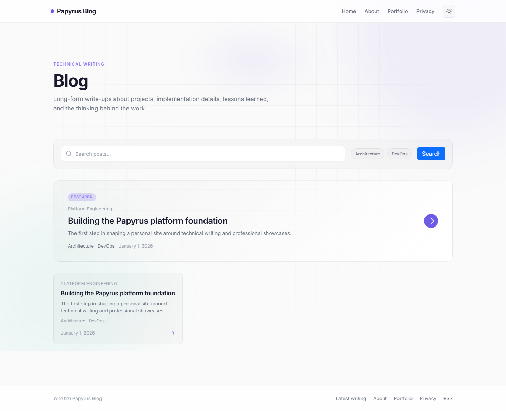
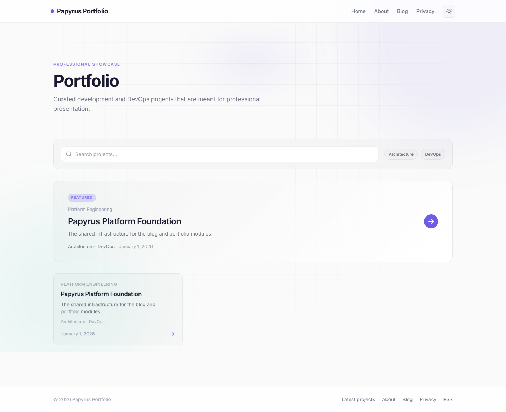
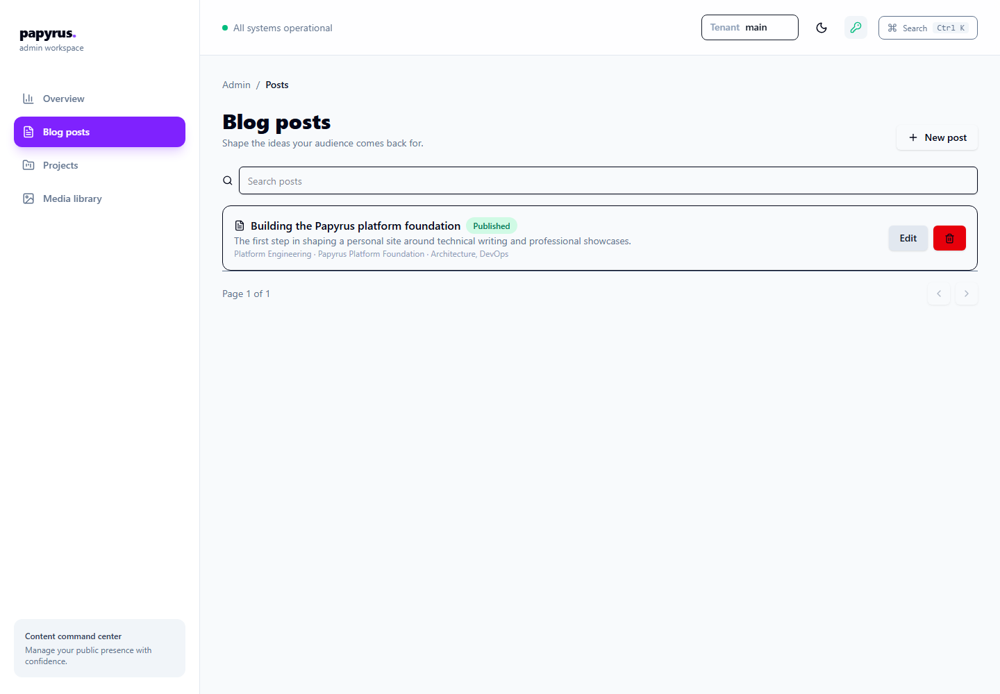
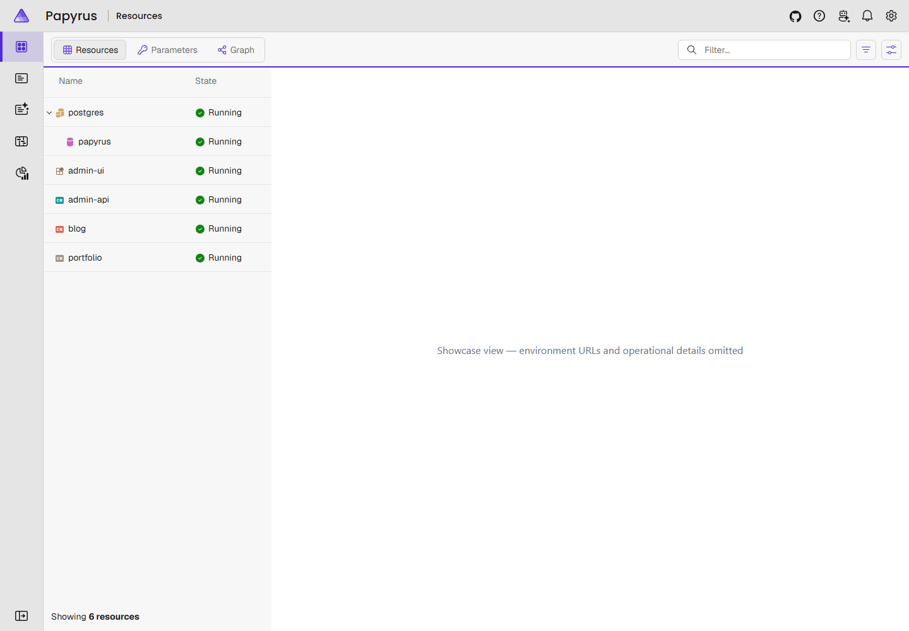

# Papyrus

Papyrus is a personal site with multiple modules:

- **Blog** for long-form technical write-ups, project notes, and working logs
- **Portfolio** for a curated professional showcase of real development and DevOps work
- **Admin API** for authenticated content management

## Current architecture

- .NET 10
- Razor Pages for the public site
- ASP.NET Core minimal API for admin operations
- PostgreSQL + Entity Framework Core
- Aspire for local orchestration
- Multi-tenant content and media isolation, with `main` as the default tenant
- React SPA admin UI with API-key authentication
- Three multi-stage, non-root Docker images (Admin, Blog, Portfolio)
- CI/CD workflows for validation, image scanning, SBOM generation, schema-diff checks, and release deployment

## Admin authentication

The Admin API uses the `X-Admin-Api-Key` header and the React admin UI sends the
configured value only to protected API routes. Development credentials are
provided by the local AppHost and must never be reused in another environment.
There is no browser session-cookie or server-side Razor login flow.

## Content model

- `Project` represents portfolio work
- `BlogPost` represents the detailed technical write-up
- `ContentCategory` groups both projects and posts
- `ContentTag` can be attached to both projects and posts
- `ProjectTag` and `BlogPostTag` provide many-to-many links

## Running locally

```powershell
dotnet restore Papyrus.sln
npm ci --prefix src/Papyrus.Admin.UI
dotnet run --project src/Papyrus.AppHost
```

Follow the [local setup and demo guide](docs/guides/local-setup.md) for
prerequisites, URLs, seed behavior, and the first published post.

## Showcase

These screenshots use the local seeded demo content and contain no credentials,
private URLs, or personal data.










## Repository documentation

- [`docs/`](docs/) is the documentation home, with navigation in [`docs/README.md`](docs/README.md).
- [`docs/guides/contributing.md`](docs/guides/contributing.md) explains local setup, verification, conventions, and pull requests.
- [`SECURITY.md`](SECURITY.md) explains private vulnerability disclosure.
- [`LICENSE`](LICENSE) grants permission under the MIT License.
- [`docs/project/changelog.md`](docs/project/changelog.md) records notable repository changes.
- [`docs/project/feature-matrix.md`](docs/project/feature-matrix.md) separates implemented capabilities from deferred and release-pending work.
- [`docs/project/roadmap.md`](docs/project/roadmap.md) contains the phased engineering roadmap and definition of done.
- [`docs/guides/deployment.md`](docs/guides/deployment.md) documents container deployment, configuration, migration ownership, and durable media requirements.
- [`docs/architecture/public-overview.md`](docs/architecture/public-overview.md) explains the public architecture and trade-offs.
- [`docs/security/threat-model-summary.md`](docs/security/threat-model-summary.md) summarizes the security posture without operational secrets.
- [`docs/project/limitations.md`](docs/project/limitations.md) records deferred capabilities and release limitations.

## Support

For setup and usage questions, start with the [documentation index](docs/README.md)
and [local setup guide](docs/guides/local-setup.md). Search existing
[GitHub Issues](https://github.com/samue/Papyrus/issues) before opening a new
issue. Use issues for reproducible bugs, documentation corrections, and
actionable feature proposals; include the Papyrus version or commit, expected
behavior, actual behavior, and safe reproduction steps. Do not post secrets or
security vulnerabilities publicly—follow [`SECURITY.md`](SECURITY.md) instead.

## Repository structure

```text
.
├── src/
│   ├── Papyrus.Core/              # Domain model and markdown rendering
│   ├── Papyrus.Application/       # Validated commands, queries, and public projections
│   ├── Papyrus.Contracts/         # REST request/response DTOs and pagination contracts
│   ├── Papyrus.Infrastructure/    # EF Core, PostgreSQL, migrations, and seed
│   ├── Papyrus.Api.Admin/         # Admin API, SPA hosting, and media
│   ├── Papyrus.Web.Blog/          # Public blog
│   ├── Papyrus.Web.Portfolio/     # Public portfolio
│   ├── Papyrus.Web.Shared/        # Shared public Razor components
│   ├── Papyrus.AppHost/           # Aspire orchestration
│   ├── Papyrus.ServiceDefaults/  # Shared service defaults
│   └── Papyrus.Tests/             # Automated tests
├── docs/                          # Architecture and security documentation
├── memory-bank/                   # Persistent project context
├── Papyrus.sln                    # Solution entry point
├── Dockerfile.admin               # Admin container image
├── Dockerfile.blog                # Blog container image
└── Dockerfile.portfolio           # Portfolio container image
```

The solution contains 11 projects. `Papyrus.Application` and
`Papyrus.Contracts` keep application workflows and REST shapes separate from
the domain and infrastructure layers, while `Papyrus.Web.Shared` provides the
shared public layout and site helpers. The three web services are deployed as
separate multi-stage containers and coordinated with Docker Compose in
production; the release workflow runs the dedicated database migration job
before deployment.

The verification baseline and phase status are maintained in the
[documentation index](docs/README.md). PostgreSQL-backed integration coverage
depends on the test database service and is exercised in CI.

## Notes

- The admin service owns database migration and seed execution; public services remain read-only.
- Seed data is added for the main tenant when the admin API starts.
- The public blog and portfolio pages read from the shared database model.
