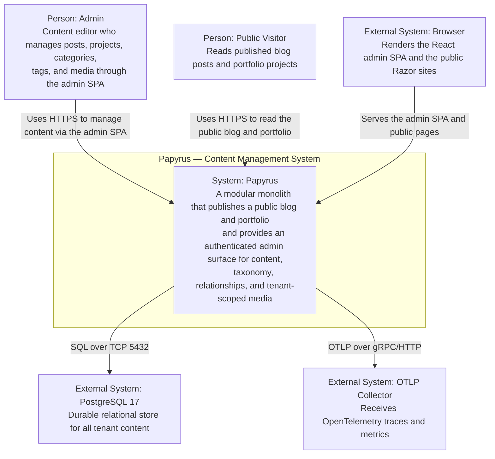
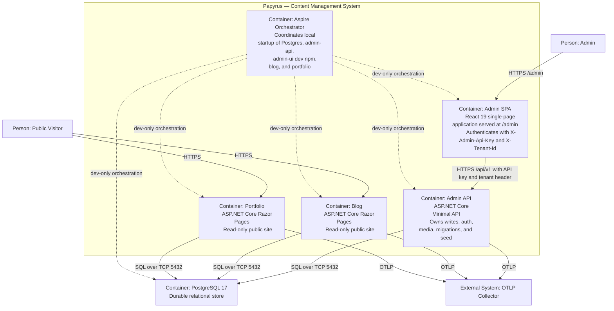
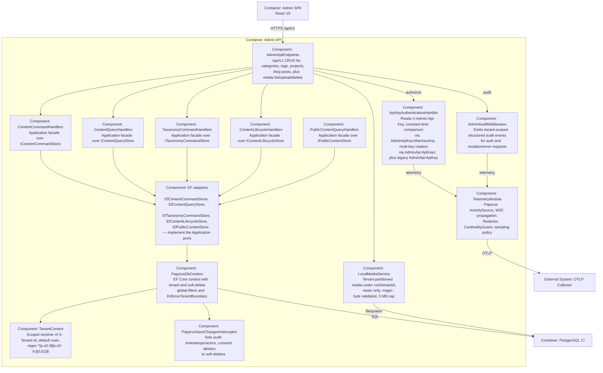

# C4 Architecture Diagrams

**Current:** the following C4 model views describe the implemented system. They are the consolidated source of truth for the C4 model (`context`, `container`, and `component` views).

## Level 1 — System Context

This is the **Level 1** view of the Papyrus architecture using the C4 Model. It shows the Papyrus system as a single black box, the people who use it, and the external systems it depends on. It answers the question: *what does Papyrus do, and who/what does it interact with?*

### Diagram

### Elements

#### People

- **Admin** — a content editor who signs in to the admin SPA and manages projects, blog posts, categories, tags, and tenant-scoped media. The admin surface is authenticated with an API key (`X-Admin-Api-Key`) and a tenant header (`X-Tenant-Id`); there is no browser session cookie.
- **Public Visitor** — an anonymous reader who browses the read-only public blog and portfolio sites. Public hosts never receive write authority.

#### The Papyrus system

Papyrus is a **modular monolith** (.NET 10, EF Core 10.0.11, React 19 admin SPA, Aspire orchestration, PostgreSQL 17 via Docker Compose). It exposes three web hosts over one shared database:

- an authenticated **Admin** host (Minimal API + React SPA) that owns writes, authentication, media, migrations, and seed;
- a read-only **Blog** host;
- a read-only **Portfolio** host.

#### External systems

- **PostgreSQL 17** — the single durable relational store. All tenant content lives here. The Admin host is the sole migration/seed owner; public hosts never migrate.
- **OTLP Collector** — receives OpenTelemetry traces and metrics from the shared `Papyrus` ActivitySource. Export is gated on `OTEL_EXPORTER_OTLP_ENDPOINT`; audit events are logger-backed and independent of OTLP availability.
- **Browser** — renders the React admin SPA (served same-origin at `/admin` in production) and the public Razor sites.

### Notes

- The system is a single deployable unit in the C4 sense: all containers share one database and are orchestrated together by Aspire (development) and Docker Compose (deployment).
- See [Level 2 — Containers](#level-2--containers) for the decomposition of this system into runnable containers.

## Level 2 — Containers

This is the **Level 2** view of the Papyrus architecture using the C4 Model. It decomposes the Papyrus system into its runnable containers and shows how they interact. It answers the question: *what are the high-level technology components of Papyrus, and how do they communicate?*

### Diagram

### Containers

#### Admin SPA (React 19)

- **Technology:** React 19 single-page application, Vite build, TypeScript.
- **Responsibility:** The sole `/admin` experience. It calls the Admin API's protected `/api/v1` endpoints with the `X-Admin-Api-Key` and `X-Tenant-Id` headers. There is no browser session cookie.
- **Deployment:** Served same-origin from the Admin API at `/admin` in production (built into the admin image via a Node stage). In development it is a dev-only `AddNpmApp` resource on port 5173 that proxies `/api/v1` to the Admin API.
- **Note:** `Papyrus.Admin.UI` is **not** a `.sln` project; it is a standalone npm app referenced by Aspire as dev-only and built into the admin image.

#### Admin API (ASP.NET Core Minimal API)

- **Technology:** .NET 10, ASP.NET Core Minimal API, EF Core 10.0.11, Npgsql.
- **Responsibility:** Authenticated content, taxonomy, and relationship CRUD; media list/upload/delete; API-key authentication; tenant enforcement; and the **sole** migration/seed owner (`InitializeDatabaseAsync()`).
- **API surface:** `/api/v1` group (versioned, documented) plus `/api` legacy (excluded from OpenAPI). Both require auth and a per-IP rate limit of 120 requests/minute. `/health` and `/alive` are anonymous. `/openapi/v1.json` is served via `MapOpenApi`. `/admin` serves the SPA shell.
- **Ports:** 5205 (Compose), 5173 proxy target in dev.

#### Blog (ASP.NET Core Razor Pages)

- **Technology:** .NET 10, Razor Pages, EF Core, shared `Papyrus.Web.Shared` presentation helpers.
- **Responsibility:** Read-only public site for technical posts, feeds, and sitemaps. Never runs migrations and never receives write authority.
- **Port:** 5075.

#### Portfolio (ASP.NET Core Razor Pages)

- **Technology:** .NET 10, Razor Pages, EF Core, shared `Papyrus.Web.Shared` presentation helpers.
- **Responsibility:** Read-only public site for projects, feeds, and sitemaps. Never runs migrations and never receives write authority.
- **Port:** 5024.

#### PostgreSQL 17

- **Technology:** PostgreSQL 17 via Docker Compose, durable volume.
- **Responsibility:** Single relational store for all tenant content. The Admin API is the sole migrator/seed owner. Npgsql retry (5×/10s) is configured.
- **Port:** 5432.

#### Aspire Orchestrator

- **Technology:** .NET Aspire AppHost.
- **Responsibility:** Coordinates local startup of PostgreSQL, admin-api, admin-ui (dev-only npm), blog, and portfolio. Blog and Portfolio wait for admin-api health and never run migrations. In production, Docker Compose and the three multi-stage, non-root Dockerfiles provide the deployment shape.

### Interactions

- **HTTP:** Admin SPA → Admin API (`/api/v1`); Public Visitor → Blog and Portfolio; Admin API serves the SPA at `/admin`.
- **SQL:** All three web hosts read from PostgreSQL; only the Admin API writes and migrates.
- **OTLP:** All three web hosts export telemetry to the OTLP collector, gated on `OTEL_EXPORTER_OTLP_ENDPOINT`.

### Notes

- See [Level 3 — Components](#level-3--components-admin-api) for the decomposition of the Admin API container into its internal components.

## Level 3 — Components (Admin API)

This is the **Level 3** view of the Papyrus architecture using the C4 Model. It decomposes the **Admin API** container into its internal components and shows how they interact. It answers the question: *what are the key building blocks inside the Admin API, and what is each responsible for?*

### Diagram

### Components

#### ApiKeyAuthenticationHandler

- **Responsibility:** Authenticates every protected request by reading the `X-Admin-Api-Key` header and comparing it in constant time via `AdminApiKey.MatchesAny`. Supports multi-key rotation through the `AdminApi:ApiKeys` set plus the legacy `AdminApi:ApiKey` alias. Uses `IOptionsMonitor<AdminApiKeyOptions>` so reload-capable configuration providers can add/overlap/remove keys. Fails fast in production if no key is configured or a default placeholder is used.

#### AdminAuditMiddleware

- **Responsibility:** Emits tenant-scoped, structured audit events for authentication and mutation/error requests through the shared `IAuditEventSink`. Audit events are logger-backed, never sampled, and never record API keys, cookies, request bodies, or raw credentials.

#### AdminApiEndpoints

- **Responsibility:** The Minimal API surface. Exposes `/api/v1` (versioned, documented) plus `/api` legacy (excluded from OpenAPI). Provides CRUD for categories, tags, projects, and blog-posts, plus media list/upload/delete. Both groups require auth and a per-IP rate limit of 120 requests/minute. `/health` and `/alive` are anonymous; `/openapi/v1.json` is served via `MapOpenApi`; `/admin` serves the SPA shell.

#### ContentCommandHandlers / ContentQueryHandlers (Application)

- **Responsibility:** The CQRS application layer. Command handlers validate and execute content create/update/soft-delete/restore and lifecycle use cases; query handlers project bounded, no-tracking DTOs for reads. They sit in `Papyrus.Application` and depend on `Papyrus.Contracts` DTOs.

#### PapyrusDbContext + TenantContext + PapyrusSaveChangesInterceptor (Infrastructure)

- **PapyrusDbContext:** The EF Core context. Applies tenant and soft-delete global query filters and calls `EnforceTenantBoundary()` to stamp `TenantId` on added entities and reject any save whose tenant differs from the current context. RLS is **not** used (ADR 0007); application-level filtering is the sole enforcement layer.
- **TenantContext:** A scoped resolver that reads the `X-Tenant-Id` header (default `main`) and validates it against `^[a-z0-9][a-z0-9-]{0,62}$`.
- **PapyrusSaveChangesInterceptor:** Sets audit timestamps/actors on save and converts deletes to soft-deletes.

#### LocalMediaService

- **Responsibility:** Manages tenant-partitioned media under `{root}/{tenantId}/`. Uploads are raster-only, magic-byte validated, capped at 5 MB, atomically written, and cannot delete referenced files.

#### TelemetryModule

- **Responsibility:** Owns the shared `Papyrus` ActivitySource, W3C trace propagation, the `TelemetryRequestMiddleware` per-request activity, the `StructuredAuditEventSink` (audit events never sampled), the fail-closed `Redactor`, the `CardinalityGuard` (default 100), and the `TelemetrySamplingPolicy` (default 1.0 for diagnostics only). OTLP export is gated on `OTEL_EXPORTER_OTLP_ENDPOINT`.

### Notes

- The Admin API is the **sole** migration/seed owner via `InitializeDatabaseAsync()`; the public hosts never migrate.
- See [Level 2 — Containers](#level-2--containers) for the container-level view, and [Level 1 — System Context](#level-1--system-context) for the system boundary.