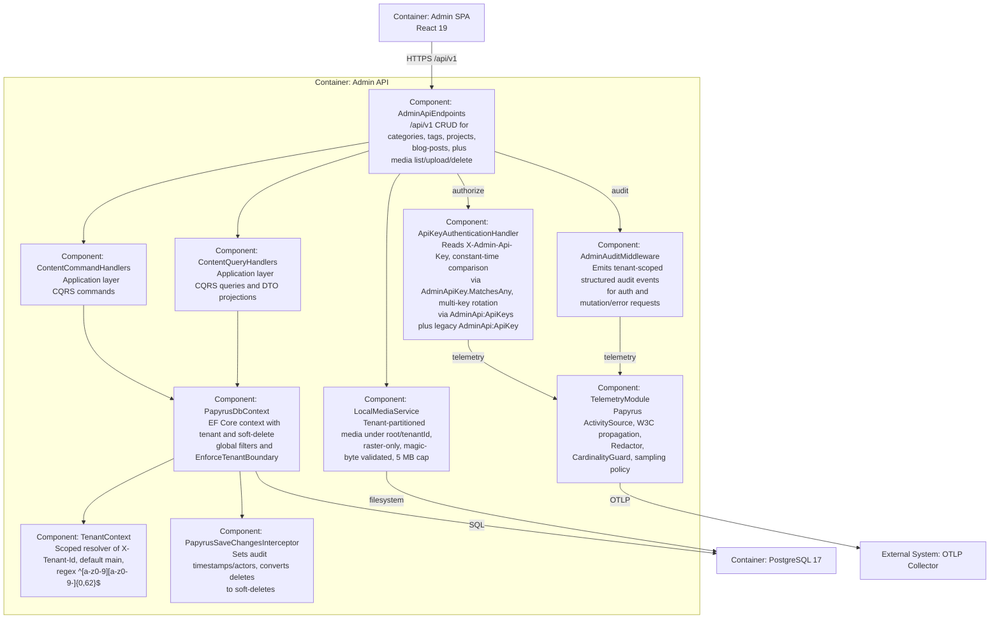

# C4 Level 3 — Components (Admin API)

This is the **Level 3** view of the Papyrus architecture using the C4 Model. It
decomposes the **Admin API** container into its internal components and shows
how they interact. It answers the question: *what are the key building blocks
inside the Admin API, and what is each responsible for?*

## Diagram

## Components

### ApiKeyAuthenticationHandler

- **Responsibility:** Authenticates every protected request by reading the
  `X-Admin-Api-Key` header and comparing it in constant time via
  `AdminApiKey.MatchesAny`. Supports multi-key rotation through the
  `AdminApi:ApiKeys` set plus the legacy `AdminApi:ApiKey` alias. Uses
  `IOptionsMonitor<AdminApiKeyOptions>` so reload-capable configuration
  providers can add/overlap/remove keys. Fails fast in production if no key is
  configured or a default placeholder is used.

### AdminAuditMiddleware

- **Responsibility:** Emits tenant-scoped, structured audit events for
  authentication and mutation/error requests through the shared
  `IAuditEventSink`. Audit events are logger-backed, never sampled, and never
  record API keys, cookies, request bodies, or raw credentials.

### AdminApiEndpoints

- **Responsibility:** The Minimal API surface. Exposes `/api/v1` (versioned,
  documented) plus `/api` legacy (excluded from OpenAPI). Provides CRUD for
  categories, tags, projects, and blog-posts, plus media list/upload/delete.
  Both groups require auth and a per-IP rate limit of 120 requests/minute.
  `/health` and `/alive` are anonymous; `/openapi/v1.json` is served via
  `MapOpenApi`; `/admin` serves the SPA shell.

### ContentCommandHandlers / ContentQueryHandlers (Application)

- **Responsibility:** The CQRS application layer. Command handlers validate and
  execute content create/update/soft-delete/restore and lifecycle use cases;
  query handlers project bounded, no-tracking DTOs for reads. They sit in
  `Papyrus.Application` and depend on `Papyrus.Contracts` DTOs.

### PapyrusDbContext + TenantContext + PapyrusSaveChangesInterceptor (Infrastructure)

- **PapyrusDbContext:** The EF Core context. Applies tenant and soft-delete
  global query filters and calls `EnforceTenantBoundary()` to stamp `TenantId`
  on added entities and reject any save whose tenant differs from the current
  context. RLS is **not** used (ADR 0007); application-level filtering is the
  sole enforcement layer.
- **TenantContext:** A scoped resolver that reads the `X-Tenant-Id` header
  (default `main`) and validates it against `^[a-z0-9][a-z0-9-]{0,62}$`.
- **PapyrusSaveChangesInterceptor:** Sets audit timestamps/actors on save and
  converts deletes to soft-deletes.

### LocalMediaService

- **Responsibility:** Manages tenant-partitioned media under
  `{root}/{tenantId}/`. Uploads are raster-only, magic-byte validated, capped at
  5 MB, atomically written, and cannot delete referenced files.

### TelemetryModule

- **Responsibility:** Owns the shared `Papyrus` ActivitySource, W3C trace
  propagation, the `TelemetryRequestMiddleware` per-request activity, the
  `StructuredAuditEventSink` (audit events never sampled), the fail-closed
  `Redactor`, the `CardinalityGuard` (default 100), and the
  `TelemetrySamplingPolicy` (default 1.0 for diagnostics only). OTLP export is
  gated on `OTEL_EXPORTER_OTLP_ENDPOINT`.

## Notes

- The Admin API is the **sole** migration/seed owner via
  `InitializeDatabaseAsync()`; the public hosts never migrate.
- See [Level 2 — Containers](container.md) for the container-level view, and
  [Level 1 — System Context](context.md) for the system boundary.
