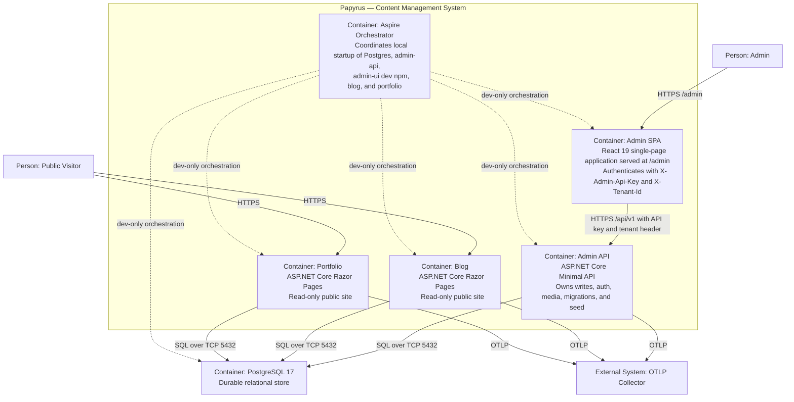

# C4 Level 2 — Containers

This is the **Level 2** view of the Papyrus architecture using the C4 Model. It
decomposes the Papyrus system into its runnable containers and shows how they
interact. It answers the question: *what are the high-level technology
components of Papyrus, and how do they communicate?*

## Diagram

## Containers

### Admin SPA (React 19)

- **Technology:** React 19 single-page application, Vite build, TypeScript.
- **Responsibility:** The sole `/admin` experience. It calls the Admin API's
  protected `/api/v1` endpoints with the `X-Admin-Api-Key` and `X-Tenant-Id`
  headers. There is no browser session cookie.
- **Deployment:** Served same-origin from the Admin API at `/admin` in
  production (built into the admin image via a Node stage). In development it
  is a dev-only `AddNpmApp` resource on port 5173 that proxies `/api/v1` to the
  Admin API.
- **Note:** `Papyrus.Admin.UI` is **not** a `.sln` project; it is a standalone
  npm app referenced by Aspire as dev-only and built into the admin image.

### Admin API (ASP.NET Core Minimal API)

- **Technology:** .NET 10, ASP.NET Core Minimal API, EF Core 10.0.11, Npgsql.
- **Responsibility:** Authenticated content, taxonomy, and relationship CRUD;
  media list/upload/delete; API-key authentication; tenant enforcement; and the
  **sole** migration/seed owner (`InitializeDatabaseAsync()`).
- **API surface:** `/api/v1` group (versioned, documented) plus `/api` legacy
  (excluded from OpenAPI). Both require auth and a per-IP rate limit of 120
  requests/minute. `/health` and `/alive` are anonymous. `/openapi/v1.json` is
  served via `MapOpenApi`. `/admin` serves the SPA shell.
- **Ports:** 5205 (Compose), 5173 proxy target in dev.

### Blog (ASP.NET Core Razor Pages)

- **Technology:** .NET 10, Razor Pages, EF Core, shared `Papyrus.Web.Shared`
  presentation helpers.
- **Responsibility:** Read-only public site for technical posts, feeds, and
  sitemaps. Never runs migrations and never receives write authority.
- **Port:** 5075.

### Portfolio (ASP.NET Core Razor Pages)

- **Technology:** .NET 10, Razor Pages, EF Core, shared `Papyrus.Web.Shared`
  presentation helpers.
- **Responsibility:** Read-only public site for projects, feeds, and sitemaps.
  Never runs migrations and never receives write authority.
- **Port:** 5024.

### PostgreSQL 17

- **Technology:** PostgreSQL 17 via Docker Compose, durable volume.
- **Responsibility:** Single relational store for all tenant content. The Admin
  API is the sole migrator/seed owner. Npgsql retry (5×/10s) is configured.
- **Port:** 5432.

### Aspire Orchestrator

- **Technology:** .NET Aspire AppHost.
- **Responsibility:** Coordinates local startup of PostgreSQL, admin-api,
  admin-ui (dev-only npm), blog, and portfolio. Blog and Portfolio wait for
  admin-api health and never run migrations. In production, Docker Compose and
  the three multi-stage, non-root Dockerfiles provide the deployment shape.

## Interactions

- **HTTP:** Admin SPA → Admin API (`/api/v1`); Public Visitor → Blog and
  Portfolio; Admin API serves the SPA at `/admin`.
- **SQL:** All three web hosts read from PostgreSQL; only the Admin API writes
  and migrates.
- **OTLP:** All three web hosts export telemetry to the OTLP collector, gated
  on `OTEL_EXPORTER_OTLP_ENDPOINT`.

## Notes

- See [Level 3 — Components](component.md) for the decomposition of the Admin
  API container into its internal components.