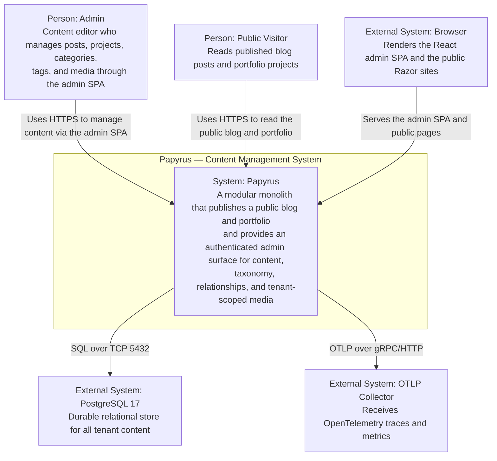

# C4 Level 1 — System Context

This is the **Level 1** view of the Papyrus architecture using the C4 Model. It
shows the Papyrus system as a single black box, the people who use it, and the
external systems it depends on. It answers the question: *what does Papyrus do,
and who/what does it interact with?*

## Diagram

## Elements

### People

- **Admin** — a content editor who signs in to the admin SPA and manages
  projects, blog posts, categories, tags, and tenant-scoped media. The admin
  surface is authenticated with an API key (`X-Admin-Api-Key`) and a tenant
  header (`X-Tenant-Id`); there is no browser session cookie.
- **Public Visitor** — an anonymous reader who browses the read-only public
  blog and portfolio sites. Public hosts never receive write authority.

### The Papyrus system

Papyrus is a **modular monolith** (.NET 10, EF Core 10.0.11, React 19 admin SPA,
Aspire orchestration, PostgreSQL 17 via Docker Compose). It exposes three web
hosts over one shared database:

- an authenticated **Admin** host (Minimal API + React SPA) that owns writes,
  authentication, media, migrations, and seed;
- a read-only **Blog** host;
- a read-only **Portfolio** host.

### External systems

- **PostgreSQL 17** — the single durable relational store. All tenant content
  lives here. The Admin host is the sole migration/seed owner; public hosts
  never migrate.
- **OTLP Collector** — receives OpenTelemetry traces and metrics from the
  shared `Papyrus` ActivitySource. Export is gated on
  `OTEL_EXPORTER_OTLP_ENDPOINT`; audit events are logger-backed and independent
  of OTLP availability.
- **Browser** — renders the React admin SPA (served same-origin at `/admin` in
  production) and the public Razor sites.

## Notes

- The system is a single deployable unit in the C4 sense: all containers share
  one database and are orchestrated together by Aspire (development) and Docker
  Compose (deployment).
- See [Level 2 — Containers](container.md) for the decomposition of this system
  into runnable containers.