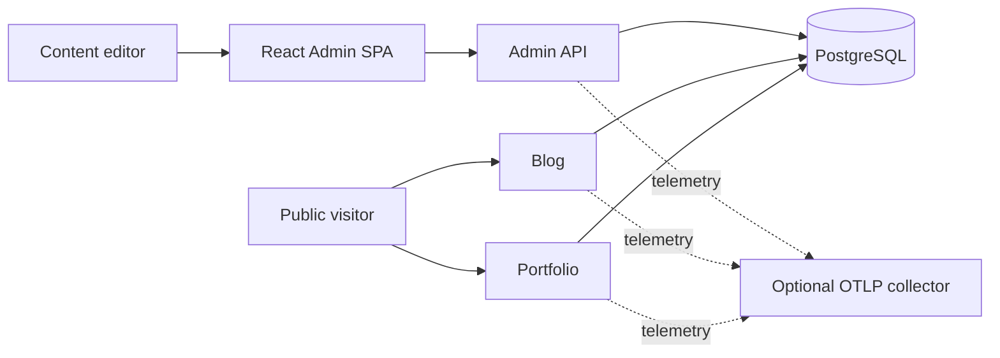
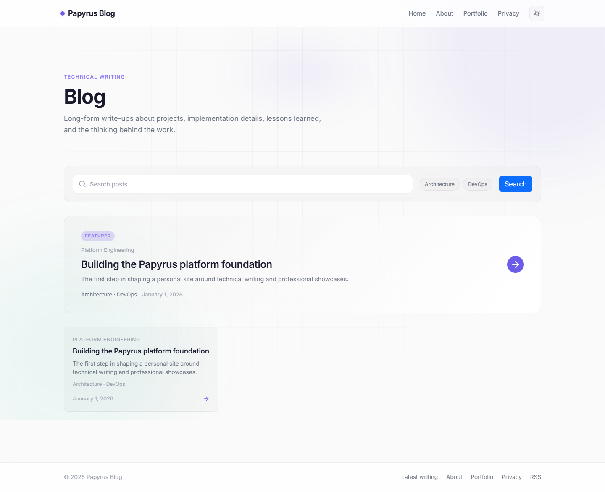
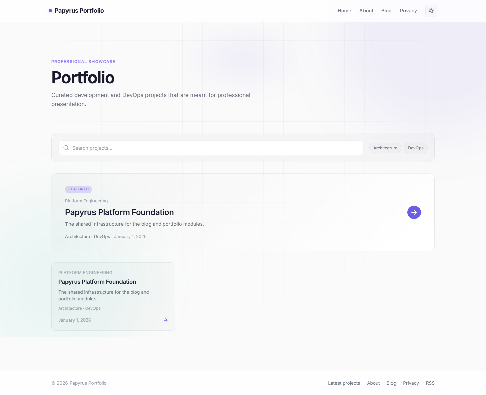
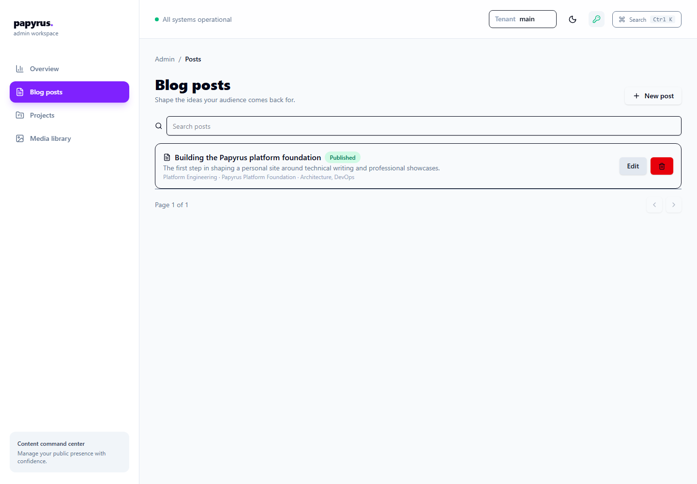
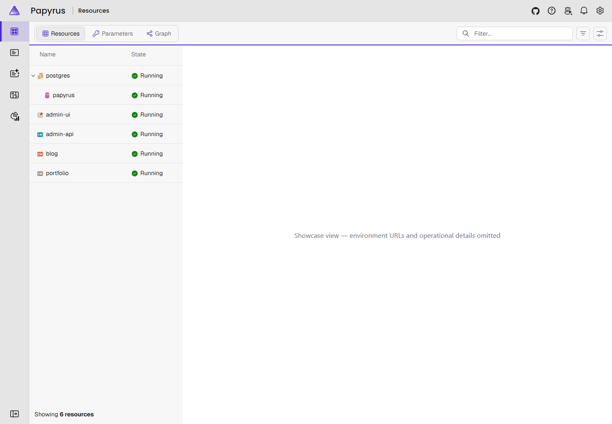

# Papyrus architecture

Papyrus is a modular-monolith platform for publishing a blog and portfolio and
managing their content. It combines three independently runnable web hosts with
one shared PostgreSQL database. The deployment shape is deliberately simpler
than a set of distributed services: modules have explicit responsibilities and
the solution keeps transactions and local development straightforward.

This page is the public explanation of the architecture. For progressively
more detail, see the [C4 views](README.md), the [architecture overview](overview.md),
and the [architecture decision records](decisions/README.md).

## Runtime at a glance

- **Admin API** is the authenticated write boundary. It exposes the documented
  `/api/v1` REST API, serves the production admin SPA at `/admin`, handles media,
  and is the sole owner of database initialization, migrations, and seed data.
- **Admin SPA** is a standalone React and TypeScript application. Aspire runs it
  through Vite during local development; the Admin image builds it into the API
  image for production.
- **Blog** and **Portfolio** are read-only Razor Pages hosts. They query public
  projections and do not receive write authority or run migrations.
- **PostgreSQL** is the shared relational store. Docker Compose provides the
  production-shaped database and durable data volumes; Aspire coordinates the
  local stack.

## Local showcase

The following sanitized captures show the five user-visible and operational
surfaces described above. They use only the local seeded demo content; the
Aspire capture intentionally omits environment URLs and operational details.

## Code boundaries

| Boundary | Responsibility |
| --- | --- |
| `Papyrus.Core` | Domain entities and safe Markdown rendering |
| `Papyrus.Application` | Validated commands, queries, use-case rules, and projections |
| `Papyrus.Contracts` | Explicit REST request/response and pagination DTOs |
| `Papyrus.Infrastructure` | EF Core, PostgreSQL mappings, filters, save enforcement, migrations, and seed |
| `Papyrus.Api.Admin` | Authentication, administrative writes, media, SPA hosting, and initialization |
| `Papyrus.Web.Blog` | Public blog presentation |
| `Papyrus.Web.Portfolio` | Public portfolio presentation |
| `Papyrus.Web.Shared` | Shared public presentation helpers |
| `Papyrus.AppHost` | Local Aspire orchestration |
| `Papyrus.ServiceDefaults` | Health, security headers, and telemetry defaults |

The Admin UI is not a .NET solution project; it is the standalone npm project at
[`src/Papyrus.Admin.UI`](../../src/Papyrus.Admin.UI/). The complete container
decomposition is in [C4 Level 2](c4/container.md), and the Admin API internals
are in [C4 Level 3](c4/component.md).

## Request and data flow

1. An administrative request presents `X-Admin-Api-Key` and may select a tenant
   with `X-Tenant-Id`. The validated tenant defaults to `main`.
2. Application handlers validate the use case and map entities to bounded DTOs.
3. EF Core applies tenant and soft-delete filters. A save-time boundary check
   prevents tracked changes from crossing tenants.
4. The Admin API persists the change. Its initialization path, and no public
   host, applies migrations and seed data.
5. Blog and Portfolio query no-tracking public projections. Draft, future, and
   deleted content is excluded from public delivery.

## Security and operational boundaries

- API keys are header-based and compared in constant time. They are not written
  to logs. Production configuration must provide a managed, non-default key.
- Tenant isolation is enforced in the application and persistence layers, with
  tenant-partitioned media paths. PostgreSQL row-level security is intentionally
  not used; this is recorded in [ADR 0007](decisions/0007-postgres-rls-decision.md).
- Uploads are constrained to validated raster media with generated names and a
  size limit. Markdown is passed through the safe renderer before display.
- Telemetry uses bounded, redacted diagnostics. Audit events are retained
  independently of diagnostic sampling; OTLP export is optional and configured
  outside the repository.

## Why a modular monolith?

The boundary gives Papyrus separation without requiring network calls between
its core use cases. It preserves a single database transaction boundary and
keeps local development reproducible. Service extraction is intentionally
deferred until measured scale, deployment, or ownership constraints justify the
additional distributed-system complexity. See [ADR 0001](decisions/0001-modular-monolith-boundaries.md).

## Related documentation

- [Local setup tutorial](../guides/tutorials/getting-started.md)
- [Deployment how-to](../guides/deployment.md)
- [API reference](../api/README.md)
- [Threat-model summary](../security/threat-model-summary.md)
- [Known limitations](../project/limitations.md)
