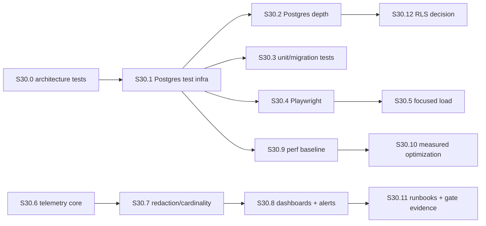

# Phase 6 — Observability, Test Depth, and Performance Budgets

**Status:** Planned (delegable to `code`, `test`, and `architect` modes)
**Roadmap anchor:** [`docs/project/roadmap.md`](../docs/project/roadmap.md) Phase 6, line 106 — "make failures diagnosable and behavior measurable."
**Scope gate:** every P0/P1 path has a test, signal, budget, and runbook.

This document authorizes **no production code, no tests, and no telemetry** by
itself. It is a plan. Each subtask below is a unit of work that a `code`,
`test`, or `architect` mode executes after approval, and each records its
evidence back here and in [`memory-bank/progress.md`](../memory-bank/progress.md).

---

## 1. Verified Phase 6 baseline

These facts were confirmed against the repository on 2026-08-29.

- Phases 0–5 are complete; Phase 6 is NOT STARTED
  ([`progress.md`](../memory-bank/progress.md:3)).
- The automated suite has **32 passing tests**, not the stale "40" cited in
  [`audit-register.md`](../docs/security/audit-register.md:14) and
  [`release-gates.md`](../docs/architecture/release-gates.md:14). The 40→32
  drop came from retiring `AdminSessionTests.cs` with the Razor removal
  (ADR 0006).
- Persistence confidence is InMemory-only.
  [`TestDb.cs`](../src/Papyrus.Tests/TestDb.cs:8) uses `UseInMemoryDatabase`.
  No PostgreSQL integration test exists.
- **No architecture/layer tests exist.** Phase 0 roadmap item 3 (block
  public-write dependencies, domain→infrastructure dependencies, non-admin
  migration ownership) was **never implemented** — overdue and now absorbed into
  Phase 6 ([`roadmap.md`](../docs/project/roadmap.md:38)).
- OpenTelemetry wiring is present but minimal in
  [`Extensions.cs`](../src/Papyrus.ServiceDefaults/Extensions.cs:48):
  ASP.NET/HTTP/Runtime instrumentation, an OTLP exporter gated on
  `OTEL_EXPORTER_OTLP_ENDPOINT`, and health checks. There is no custom
  `Telemetry` folder, no structured audit-event budget, no redaction pipeline,
  and no cardinality control.
- The admin API has an existing `AdminAuditMiddleware`
  ([`AdminAuditMiddleware.cs`](../src/Papyrus.Api.Admin/Authentication/AdminAuditMiddleware.cs))
  and a fixed-window rate limiter
  ([`Program.cs`](../src/Papyrus.Api.Admin/Program.cs:30), permit 120/min,
  keyed on `RemoteIpAddress`).
- Auth is a single process-local API key; no multi-key rotation, no replica-safe
  session store. This bounds concurrency/scale test scope (known risk #4).
- `Site__PublicBaseUrl` is **not** set in production
  ([`deployment.md`](../docs/guides/deployment.md:20)), so canonical/RSS/sitemap
  measurement is environment-gated (known risk #5).
- The build is 0-warning/0-error under `TreatWarningsAsErrors=true`. CI
  ([`ci.yml`](../.github/workflows/ci.yml:30)) runs `dotnet test` on the solution
  in Release without a live PostgreSQL instance.
- AppHost ([`Program.cs`](../src/Papyrus.AppHost/Program.cs:6)) starts
  PostgreSQL 17 and the `papyrus` database;
  [`PapyrusDbContextFactory.cs`](../src/Papyrus.Infrastructure/PapyrusDbContextFactory.cs:8)
  carries a design-time Postgres connection string.

### Constraints honored by this plan

- Preserve the modular monolith; **no** service extraction, replicas, GraphQL,
  or gRPC absent a measured bottleneck produced by Phase 6 itself.
- Layer boundaries: Core free of ASP.NET/EF/DB/media/config; Application owns
  commands/queries/projections; Infrastructure owns EF/migrations/adapters;
  Web.Shared must not mutate domain state.
- Tenant isolation = defense-in-depth; global filters are **not** the sole
  control.
- .NET 10 / C# nullable, `TreatWarningsAsErrors=true`. Reads are
  async/cancellable/`.AsNoTracking()`/projected/bounded/N+1-checked.
- Never edit applied migrations under `Papyrus.Infrastructure/Migrations`.
  Phase 6 may add new (non-history-rewriting) migrations only.
- Cap telemetry cardinality and sample safely; retain security/audit events even
  if diagnostic volume is reduced.
- Fail-closed production defaults; no checked-in secrets; redaction is
  fail-closed; P1 subtasks never weaken a security or audit gate.

---

## 2. Execution sequence (dependency-ordered)

Legend: IDs reference subtasks in Section 4. Solid arrows are hard dependencies.

Ordering principle: **architecture tests and PostgreSQL confidence come first**
(they de-risk everything else), **telemetry core is independent and runs in
parallel**, and the **performance baseline and runbooks come last** because they
consume every earlier artifact.

High-level execution sequence:

1. **S30.0 — Architecture tests** (P1). Self-contained, no Postgres, no infra.
   Closes the overdue Phase 0 gate and verifies boundaries before new telemetry
   code is added.
2. **S30.1 — PostgreSQL integration test infra** (P1). The largest risk-reducing
   lift. Compose PostgreSQL 17 already exists; add a reusable Postgres fixture
   and a CI service container.
3. **S30.6 — Telemetry core: instrumentation seams + structured audit events**
   (P1). Runs in parallel with S30.1. Audit/security events are the first
   consumers and are never dropped.
4. **S30.7 — Tenant-safe redaction + cardinality/sampling** (P1/P2). Builds on
   telemetry core; secures log/trace bounds.
5. **S30.2 / S30.3 / S30.4 — Postgres depth, unit/migration, Playwright**
   (P1/P2). Re-host InMemory smoke tests onto Postgres, add provider/concurrency/
   migration coverage, add browser smoke.
6. **S30.5 — Focused load tests** (P2). Bounded by the process-local auth model.
7. **S30.9 — Performance baseline + budgets** (P1). Requires Postgres infra and
   telemetry bounds present; records p95, query count, payload, upload cost,
   error rate, allocations. **S30.10 — measured optimization** (P2) follows only
   on baseline deltas.
8. **S30.8 / S30.11 — Dashboards, alerts, runbooks, release-gate evidence**
   (P1/P2). Last; consumes telemetry signals and budget numbers; corrects stale
   docs.

Compiling/testing is preserved at every step: each subtask keeps the solution
buildable (`dotnet build Papyrus.sln --no-restore`; 0-warn/0-error) and the
suite green (`dotnet test`) after it lands. No long-lived broken states.

---

## 3. Workstream mapping

| Workstream | Subtasks | Priority |
| --- | --- | --- |
| 1. Observability/telemetry | S30.6, S30.7, S30.8, S30.11 | P1 |
| 2. Testing-pyramid expansion | S30.0, S30.3, S30.4, S30.5 | P1/P2 |
| 3. PostgreSQL test depth | S30.1, S30.2, S30.12 | P1 |
| 4. Performance measurement | S30.9 | P1 |
| 5. Measured optimization + budgets | S30.10 | P2 |
| Architecture (overdue Phase 0) | S30.0 | P1 |

---

## 4. Discrete, delegable subtasks

### S30.0 — Architecture/layer test suite (overdue Phase 0) — P1 — Implemented

- **Scope:** implement Phase 0 roadmap item 3; add structural rules asserting
  layer dependencies and migration ownership.
- **Target paths:**
  - Create `src/Papyrus.Tests/Architecture/`
  - `src/Papyrus.Tests/Architecture/LayerDependencyTests.cs`
  - `src/Papyrus.Tests/Architecture/MigrationOwnershipTests.cs`
- **Tooling decisions:** prefer `NetArchTest.Rules` (MIT) for readable structural
  rules; pin a published version and validate in CI. If adding a package is
  undesirable, fall back to a `System.Reflection` assembly-reference traversal
  (documented either way).
- **Deliverables:**
  - Rules: no public-write dependencies crossing seams except through Application
    ports/repositories; no `Papyrus.Core` → `Papyrus.Infrastructure`/EF/Media; no
    `Papyrus.Web.Shared` → `Papyrus.Infrastructure`/`Papyrus.Application`; a
    single migration-ownership assertion that only `Papyrus.Api.Admin` (its
    designated migrator) authorizes `Migrate()`, and no other service drops
    schema.
- **AC:**
  - Runs in CI on every push/PR.
  - An intentional boundary-crossing probe project fails the build — 0 false
    negatives.
  - No source project modified; only `src/Papyrus.Tests` + CI.
- **Executing mode:** `test` (unit-test skill) + `code` if a package/CI wiring
  is needed.
- **Notes:** independent of Postgres; can start immediately.

**Evidence (2026-08-29):** Added `NetArchTest.Rules` 1.3.2 and the two target
test files under `src/Papyrus.Tests/Architecture`. Eight architecture tests pass:
Core dependency isolation (2), public contract isolation, Web.Shared
presentation-only isolation, public delivery isolation, Application delivery
isolation, Infrastructure migration ownership, and Admin-only migration startup.
The solution builds with 0 warnings/0 errors and the complete xUnit suite passes
40/40. Existing CI solution test execution includes these tests.

---

### S30.1 — PostgreSQL integration test harness — P1

- **Scope:** replace reliance on EF InMemory for authority with a
  PostgreSQL-based fixture plus a Compose/CI path.
- **Target paths:**
  - Create `src/Papyrus.Tests/Integration/`
  - `src/Papyrus.Tests/Integration/PostgresFixture.cs`
  - `src/Papyrus.Tests/Integration/PostgresTest.cs`
  - Extend `src/Papyrus.Tests/TestDb.cs` (add `CreatePostgres()`; keep InMemory
    for pure unit tests)
  - Update `.github/workflows/ci.yml` (service container) and
    `docker-compose.yml` (test service)
- **Tooling decisions:** use the `postgres`/`papyrus` services already declared
  in the AppHost; add a GitHub Actions `services:` container
  (`postgres:17-alpine`, port 5432) with a test-only DB `papyrus_test`. No new
  client package (Npgsql is already referenced). Use xUnit collection fixtures
  to run real migrations once per collection.
- **Deliverables:**
  - A fixture that builds a `PapyrusDbContext` against Postgres, applies real
    migrations (`MigrateAsync`), seeds a known tenant, and disposes cleanly.
  - A documented seam so each collection uses a unique tenant/DB to avoid
    cross-tenant leakage.
- **AC:**
  - `dotnet test` against live Postgres 17 passes in CI.
  - Integration tests require zero InMemory fallback; InMemory remains only for
    pure, provider-independent unit tests.
  - No schema change; no migration authored by this subtask.
- **Executing mode:** `code` + `test` (unit-test skill).
- **Notes:** critical path; unblocks all Postgres-depth, load, and baseline work.

**Evidence (2026-08-29):** Added the reusable xUnit collection fixture and six
PostgreSQL integration tests in `src/Papyrus.Tests/Integration`. The fixture
uses `PAPYRUS_TEST_CONNECTION_STRING` (defaulting to the Compose test database),
applies the existing migrations with `MigrateAsync`, and seeds the known
`integration` tenant. Coverage includes provider/migration connectivity,
transaction rollback, optimistic concurrency, tenant/soft-delete filters,
tenant-leading partial indexes, and no-tracking projection shape. Added the
Compose `test-db` profile and the CI `postgres:17-alpine` service container.
Verification: PostgreSQL integration tests 6/6; complete solution 46/46;
`dotnet build .\Papyrus.sln --nologo --no-incremental` 0 warnings/0 errors.

---

### S30.2 — PostgreSQL provider-behavior / concurrency / transaction / filter tests — P1

- **Scope:** exercise Postgres-only behaviors the InMemory provider cannot cover:
  index enforcement, transactions/rollback, optimistic concurrency, global and
  tenant filters, N+1 projection checks, trigram (`pg_trgm`) search, pagination
  bounds.
- **Target paths:**
  - `src/Papyrus.Tests/Integration/PostgresBehaviorTests.cs`
  - `src/Papyrus.Tests/Integration/ConcurrencyTests.cs`
  - `src/Papyrus.Tests/Integration/FilterAndProjectionTests.cs`
  - `src/Papyrus.Tests/Integration/IndexTests.cs`
- **Deliverables:** prove soft-delete exclusion, tenant-filter isolation under
  Postgres, composite-key indexes present, transactions roll back atomically, and
  N+1 is caught (a projection sanity test or a query-counting helper).
- **AC:**
  - Tests reference the designed SQL/index intents in
    [`Configurations/`](../src/Papyrus.Infrastructure/Configurations) and
    migrations — trigram and `IsDeleted`/`TenantId` partial indexes exercised by
    real queries.
  - Coverage maps to the Phase 3 gate: PostgreSQL tests cover concurrency,
    soft delete, restore, rollback, composite keys, no-tracking projections,
    reviewed complex SQL.
  - No migration authored; schema unchanged.
- **Executing mode:** `test` (unit-test skill) + `code` for query-count helpers.

**Evidence (2026-08-29):** Completed the PostgreSQL depth suite using the S30.1
fixture and real migrations. Fourteen integration tests now cover Npgsql/provider
connectivity, `ILIKE` search and pagination, `pg_trgm` extension/index usage,
tenant and soft-delete filters, no-tracking set-based projections, transaction
rollback/isolation, optimistic concurrency, concurrent partial-unique index
enforcement, and save-boundary tenant protection. No migration was added or
modified. Verification: PostgreSQL integration tests 14/14 passed.

---

### S30.3 — Handler unit tests + migration-drift tests — P1

- **Scope:** expand domain unit tests; add a migration-drift (pending-model)
  guard and a snapshot consistency test.
- **Target paths:**
  - `src/Papyrus.Tests/Application/` (handler unit tests)
  - `src/Papyrus.Tests/Migrations/` + `PendingModelChangesTests.cs`
- **Deliverables:**
  - Unit tests for content commands/queries and lifecycle handlers (InMemory
    pure unit, or Postgres-backed where a handler depends on EF behavior).
  - Migration-drift: `GenerateCreateScript()`/model-snapshot consistency plus a
    `has-pending-model-changes` gate enforced in CI.
- **AC:** new tests run in CI; the pending-model gate fails on unexpected drift;
  no migration authored (the drift test guards an already-clean state).
- **Executing mode:** `test` (unit-test skill).

**Evidence (2026-08-29):** Added InMemory handler coverage for content
commands/queries, public feed/search/detail queries, taxonomy creation and
validation, and lifecycle soft-delete/restore paths. Added migration-drift
tests using EF `HasPendingModelChanges()` plus migration snapshot and
`GenerateCreateScript()` consistency checks. No migration was authored or
modified. Verification: 60/60 solution tests and a zero-warning,
zero-error solution build.

---

### S30.4 — HTTP security/contract + browser smoke (Playwright) — P1

- **Scope:** extend existing contract tests; add browser smoke for the admin SPA
  and public pages.
- **Target paths:**
  - Create `tests/e2e/` with `playwright.config.ts`
  - `tests/e2e/admin.smoke.spec.ts`, `tests/e2e/public.smoke.spec.ts`
  - Extend `src/Papyrus.Tests/ApiContractTests.cs`
- **Tooling decisions — concrete choice: Playwright.** It fits the strict-TS
  conventions ([`tsconfig.app.json`](../src/Papyrus.Admin.UI/tsconfig.app.json)),
  tracks a lockfile, and launches against the Aspire admin-api or a static
  build. Run in CI as a non-required smoke job via an `test:e2e` npm script.
- **Deliverables:**
  - Strict-typed specs: admin SPA renders; versioned `/api/v1` requires
    `X-Admin-Api-Key`; unauthenticated reads reach no admin content; public
    pages reachable.
- **AC:** browser smoke passes against a local Aspire/static build in CI;
  fast-fails on a security regression; no `.any` in test types.
- **Executing mode:** `code` (harness) + `test` (specs).

**Evidence (2026-08-29):** Completed `tests/e2e` with Playwright 1.55.0,
strict TypeScript Node typings, and five browser smoke tests: unauthenticated
versioned-admin rejection, authenticated admin API access, admin SPA post
creation, public Blog rendering, and public Portfolio rendering. CI includes a
non-required browser-smoke job with PostgreSQL 17, built Admin UI, all three
web hosts, Chromium installation, and Playwright artifact upload. The admin
write test seeds the API key through the SPA's local-storage auth seam. Local
verification: 5/5 browser tests passed.

---

### S30.5 — Focused load tests (K6) — P2

- **Scope:** focused concurrency/scale tests bounded by the single-API-key auth
  limit.
- **Target paths:**
  - `tests/load/k6/` (`public-listing.js`, `admin-write.js`) and
    `tests/load/README.md`
- **Tooling decisions — concrete choice: K6 (Grafana).** Scriptable,
  CI-friendly, fits the strict-typing conventions. Run against a Postgres-backed
  app; document that the fixed-window 120/min limiter requires distinct IPs for
  admin load or accepts 429s.
- **Deliverables:** public read load (concurrent GETs) establishing p95 + error
  rate; admin write load capped at the known limiter, asserting 429 not 5xx;
  thresholded CI-smoke (no PR soak).
- **AC:** reproducible p95/error numbers that feed S30.9; a PR-sized load slot
  under 2 minutes; never a soak in CI.
- **Executing mode:** `code` (scripts) + `test` (assertions). P2.

---

### S30.6 — Telemetry core: instrumentation seams + structured audit events — P1

- **Scope:** create `Papyrus.ServiceDefaults/Telemetry/`; structured events, trace
  propagation, structured audit events (roadmap item 1).
- **Target paths:**
  - Create `src/Papyrus.ServiceDefaults/Telemetry/` (namespace
    `Papyrus.ServiceDefaults.Telemetry`)
  - `TelemetryActivitySource.cs`, `TelemetryOptions.cs`, `TelemetryModule.cs`,
    wired from [`Extensions.cs`](../src/Papyrus.ServiceDefaults/Extensions.cs)
  - Structured audit event: tenant-scoped actor/action/target/correlation id;
    never logs the API key.
- **Scope guards:** no new log-collector dependency; keep the OTLP exporter
  gate; audit log active in Production defaults (fail-closed).
- **Tooling decisions:** existing `OpenTelemetry.* 1.18` +
    `System.Diagnostics.ActivitySource`. One `Papyrus` activity-source name
    across services.
- **Deliverables:** `ActivitySource.StartActivity` around command/query handlers;
  an `AuditEvent` structured log integrated with the existing
  `AdminAuditMiddleware`.
- **AC:** trace/activity ids propagate to OTLP when configured; the default
  no-OTLP path still records audit locally; no credential/cookie/raw data beyond
  tenant id in audit logs; the existing `AdminAuditMiddleware` is rationalized to
  the new seams.
- **Executing mode:** `code`.

**Evidence (2026-08-29):** Added the shared `Papyrus` W3C `ActivitySource`,
structured logger-backed audit sink, stable request instrumentation seam, and
telemetry registration in `Extensions.cs`. Admin API-key authentication emits
success/failure audit events; Admin mutation/error requests emit tenant-scoped
structured events; Blog and Portfolio use the shared request seam. Audit events
remain logger-backed independently of diagnostic sampling and OTLP availability.
No persisted audit table was selected, so no migration was added. Three
telemetry unit tests cover structured fields, local audit fallback, and W3C
activity IDs. Verification: 49/49 solution tests and a 0-warning/0-error build.

---

### S30.7 — Tenant-safe redaction + cardinality/sampling control — P1 — Implemented

- **Scope:** enforce redaction and cardinality/sampling fail-closed across logs
  and traces; retain audit events even at 0% diagnostic sampling.
- **Target paths:**
  - `src/Papyrus.ServiceDefaults/Telemetry/Redaction/` (`Redactor.cs`,
    `RedactionPolicy.cs`)
  - `CardinalityOptions.cs` + sampling policy; config
    `Telemetry__CardinalityLimit`, `Telemetry__SamplingRate`
- **Scope guards:** audit/security events are **never sampled away**; sampling
  applies only to high-volume diagnostic trace/metrics; explicit rollback note.
- **Deliverables:** an allowlist of emitted fields plus a redactor run before
  `ILogger`/OTel pipeline; a cardinality guard on tenant/route/status-tagged
  metrics that rejects runaway unique tag values.
- **AC:** banned strings (API key, session id, token) are absent from serialized
  logs; a test proves the audit event survives at forced 0% diagnostic volume.
- **Executing mode:** `code` + `test` (redactor unit tests).

**Evidence (2026-08-29):** Added fail-closed audit redaction at the structured
sink seam, bounded diagnostic tag cardinality, and configurable request
diagnostic sampling. Audit logging remains outside the sampling decision and
is emitted at a forced 0% diagnostic rate. Added tests for secret/identity
redaction, audit retention, and cardinality overflow. Verification: 63/63
solution tests and a clean zero-warning/zero-error build; no migrations changed.

---

### S30.8 — Dashboards and alerts — P2

- **Scope:** canonical dashboard/alerts mapping telemetry signals to runbooks.
- **Target paths:** `ops/dashboards/` (`papyrus-dashboard.json`, portable
  Grafana/Prometheus) and `docs/runbooks/alerts.md`.
- **Tooling:** portable OTel-compatible definitions; no hosted vendor dependency.
- **Deliverables:** a dashboard; an alert-family doc (latency p95, error rate,
  429s, audit-event rate, GC/allocation); an alert-to-runbook map.
- **AC:** every alert maps 1:1 to a telemetry signal from S30.6/S30.7; a
  security/audit volume drop triggers an alert (never silently silenced); the
  map is committed.
- **Executing mode:** `code` (dashboard/alert files) + `architect` (alerts doc).
  P2.

---

### S30.9 — Performance baseline + budget scaffolding — P1

- **Scope:** record roadmap item 4 baseline: p95 public/admin latency, query
  count, payload size, upload cost, error rate, allocation/GC under the
  Postgres-backed app.
- **Target paths:**
  - `docs/performance/phase6-baseline.md`
  - `.github/workflows/perf-baseline.yml` (manual/dispatch)
  - Extend `tests/load/k6/` scenarios (reuse S30.5)
- **Tooling:** k6 p95/error outputs to a committed baseline marker; `dotnet
  counters`/`dotnet-monitor` for GC/allocation; a query-counting helper (EF
  `CommandExecutonListener` or interceptor) asserting per-request counts in a
  budget test.
- **Deliverables:** baseline table (p95, queries/request, payload bytes, upload
  cost, error rate, Gen0/1/2, allocations/request); a budget test that fails
  when a known P0 read path regresses past the threshold.
- **AC:** baseline committed with env pins (CPU, PG version, seed size); budget
  test is CI-or-dispatch gated (not a per-PR soak); `Site__PublicBaseUrl` noted
  unset (a relative-URL baseline plus a documented step to re-measure at
  production).
- **Executing mode:** `code` + `test`.

---

### S30.10 — Measured optimization + bounded budgets — P2

- **Scope:** act only on baseline deltas; async I/O, cancellation tokens,
  projections, bounded results, measured optimization. Explicitly avoid
  speculative allocation tricks.
- **Target paths:** `AdminApiEndpoints.cs`, `PublicContentQueries.cs`,
  projections, and handler paths — only where the baseline proves a need.
- **Deliverables:** a before→after measurement log; the same budget test green;
  numbers improved or held.
- **AC:** every optimization is paired with a baseline measurement; no blind
  `Span` micro-opt; no new external effect/outbox/service; stays within
  boundaries.
- **Executing mode:** `code`.
- **Out of scope (explicit):** no speculative allocation tricks; no
  services/replicas; no new DB provider; do not re-architect in-budget paths.

---

### S30.11 — Runbooks and release-gate evidence — P1

- **Scope:** runbook set; correct the stale "40 tests" docs; attach release-gate
  evidence (W7/O4 telemetry+audit, O8 perf, O10 architecture).
- **Target paths:**
  - `docs/runbooks/` (`incident-runbook.md`, `telemetry-runbook.md`)
  - Update [`audit-register.md`](../docs/security/audit-register.md),
    [`release-gates.md`](../docs/architecture/release-gates.md), and
    [`deployment.md`](../docs/guides/deployment.md)
- **Deliverables:** incident classes (401/429/5xx/health/audit-loss) with
  diagnosis (trace id, query count, audit) and revert steps; telemetry runbook;
  gate checklists pointing at subtask outputs.
- **AC:** every incident class has a runbook; alerts map 1:1; deployment doc
  updated for the OTLP endpoint and runbook links; audit register no longer shows
  "40".
- **Executing mode:** `architect` (docs/framework) + `code` (links).

---

### S30.12 — (Optional) Postgres RLS defense-in-depth decision — P2

- **Scope:** close roadmap Phase 1 item 4 with a recorded ADR decision on whether
  to add RLS as a second enforcement layer. Not a mandatory implementation.
- **Target paths:** `docs/architecture/decisions/` new ADR; a real Postgres test
  if selected.
- **Deliverables:** RLS selected/declined with rationale and the "filters not
  sole control" note; if selected, a policy-boundary integration test.
- **Executing mode:** `architect` + `code`/`test` if selected. P2.

---

## 5. Migration note

The `papyrus` DB already carries five applied migrations under
`Papyrus.Infrastructure/Migrations`. Phase 6 **does not** require a new
migration for the audience path — audit events are log/OTL only, no table. If
S30.6/S30.7 decide a **persisted** audit table is required (retain events even
if the collector is down), that is the **only** justification for a **new**
migration, authored as a non-history-rewriting migration under
`Papyrus.Infrastructure/Migrations` and reviewed. All other subtasks require
**no migration**; schema stays snapped to the model. The migration-drift test
(S30.3) protects this.

**Migration-affected subtasks:** S30.6 (potential, if an audit table is added).
All others: **no migration**.

## 6. Out-of-scope statements (do not implement in Phase 6)

1. No service extraction, read replicas, GraphQL, gRPC, dedicated search,
   background worker, or outbox consumer. These are Phase 8 decision-gate
   candidates only after Phase 6 evidence.
2. No speculative allocation tricks in workstream 5. Only measured,
   baseline-paired improvement; nothing before a measurement.
3. No rewrite or movement of the five applied migrations; only new additive
   migrations through the approved process.
4. No new DB provider or persistence engine; PostgreSQL 17 via Npgsql only.
5. No external log/APM vendor lock-in; the OTLP exporter gate is preserved.
   Dashboards/alerts are portable definitions, not a hosted dependency.
6. No changes to the tenant auth model (still a single process-local API key;
   no multi-key rotation in Phase 6 — a known risk and a later item).
7. No production `Site__PublicBaseUrl` value is hard-coded; setting it is a
   deployment-time action, not a Phase 6 code change.
8. No weakening of a security/audit gate to satisfy a lower cardinality target;
   audit events always retained.

## 7. First P1 batch ready to delegate

1. **S30.0 — Architecture/layer tests** (`test`). Immediate; closes the overdue
   Phase 0 gate.
2. **S30.1 — Postgres integration test harness** (`code` + `test`). Critical
   path; unblocks all Postgres-depth, load, and baseline work.
3. **S30.6 — Telemetry core + structured audit events** (`code`). Parallel;
   unblocks redaction, dashboards, runbooks, and gates W7/O4.
4. **S30.3 — Migration-drift + handler unit tests** (`test`). Small; protects
   the schema invariant.

Delegate these first; then S30.2 (Postgres depth), S30.4 (Playwright), S30.7
(redaction/cardinality), S30.9 (baseline), S30.11 (runbooks) as the Postgres
infra lands. P2: S30.5 (load), S30.10 (measured optimization), S30.12 (RLS
ADR), and dashboard definitions.
